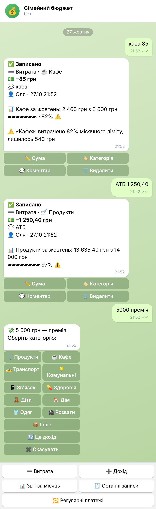
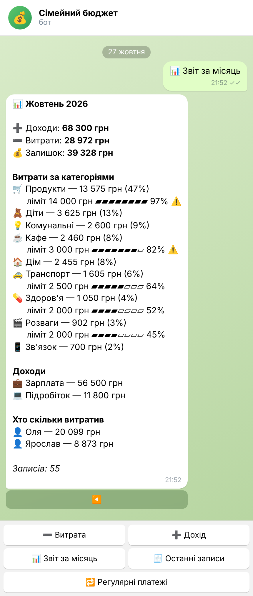
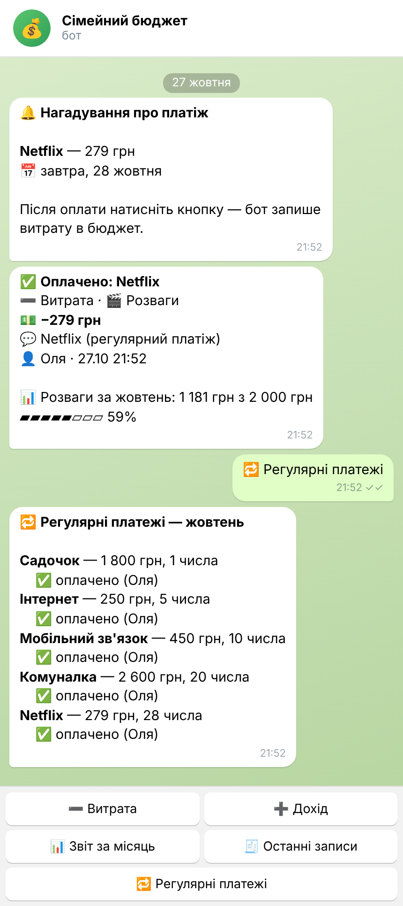
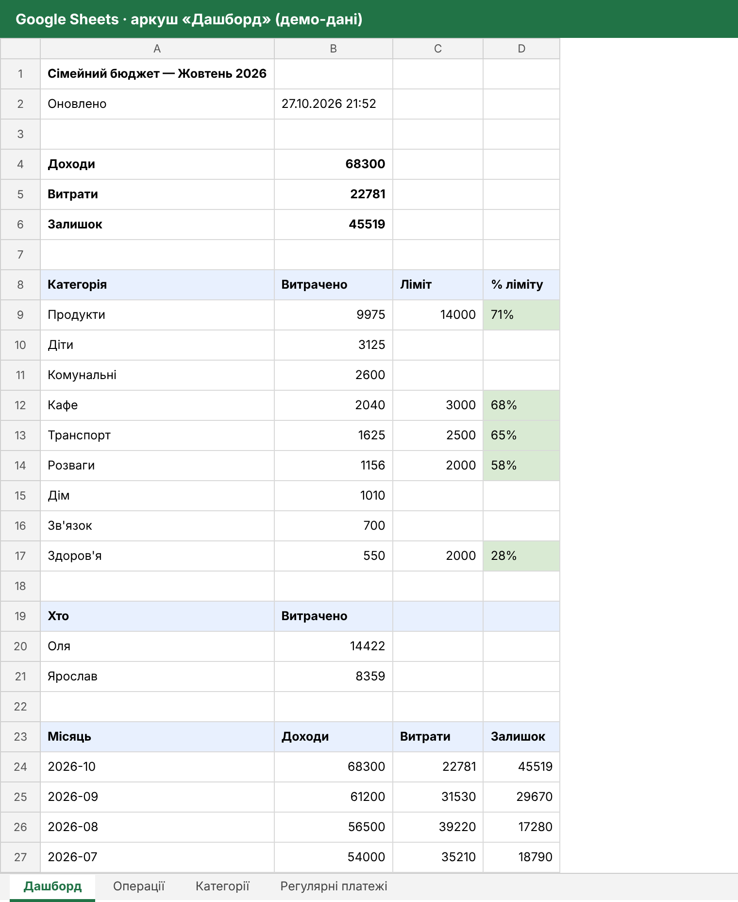
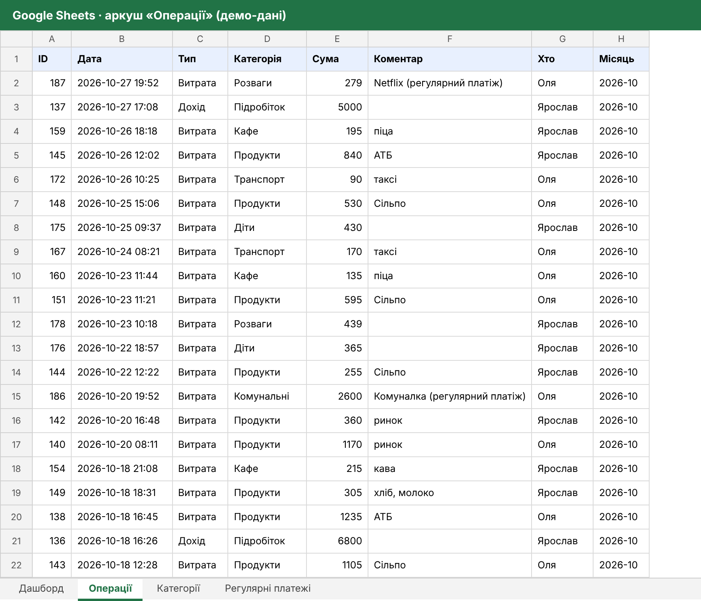
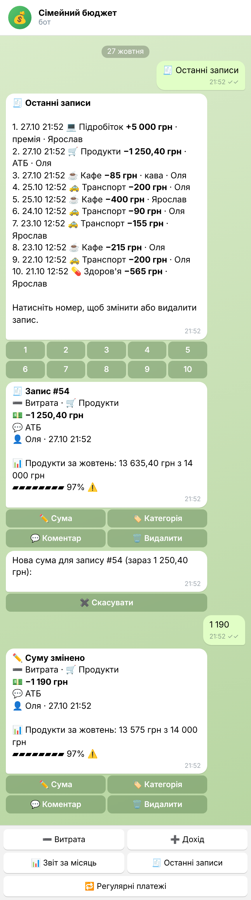

# Сімейний бюджет у Telegram + Google Sheets

Telegram-бот для обліку доходів і витрат сім'ї. Кожен член сім'ї записує витрати зі свого телефону за кілька секунд. Бот підставляє категорію, стежить за лімітами, нагадує про регулярні платежі й автоматично веде Google-таблицю з дашбордом.

<p>



</p>

_Скріншоти зроблені з реальних відповідей бота: сценарії проганяються через хендлери скриптом `tools/demo_transcript.py`. Дані демо._

## Що вміє

**Запис витрат і доходів**
- **Швидкий запис одним повідомленням:** `кава 85`, `1250 АТБ`, `таксі 120+95`. Якщо слово знайоме, категорію бот ставить сам: «АТБ» → Продукти, «таксі» → Транспорт. Якщо ні, показує кнопки категорій.
- **Звичайний шлях через кнопки:** «➖ Витрата» / «➕ Дохід» → категорія → сума → коментар (можна пропустити).
- **Суми в зручному форматі:** `1 250,50`, `99 грн`, `120+85+40`.
- **Автор запису:** у кожному записі видно, хто його додав і коли.

**Редагування**
- Під кожним записом є кнопки «✏️ Сума», «🏷 Категорія», «💬 Коментар», «🗑 Видалити» (видалення з підтвердженням).
- «🧾 Останні записи» показує 10 останніх; натисніть номер, щоб відкрити запис.

**Ліміти та звіти**
- **Місячний ліміт на категорію:** у картці запису видно прогрес. Попередження приходить один раз при досягненні 80% і один раз при перевищенні, а не на кожну покупку.
- **Звіт за місяць:** доходи, витрати, залишок, розподіл за категоріями з лімітами, хто скільки витратив. Кнопками ◀️ ▶️ можна гортати місяці.

**Регулярні платежі**
- Інтернет, комуналка, садочок тощо. За N днів до дати бот нагадує всім членам сім'ї.
- Кнопка «✅ Оплачено» записує витрату. Якщо двоє натиснуть одночасно, запис буде тільки один, а другий побачить «Вже оплачено (Оля)».
- «✏️ Інша сума» — для платежів, сума яких змінюється (комуналка).
- Якщо видалити запис оплати, платіж знову стане неоплаченим.

**Google Sheets**
- **Аркуш «Операції»:** усі записи. Бот додає, змінює і видаляє рядки за ID.
- **Аркуш «Дашборд»:** поточний місяць, ліміти з відсотками, хто скільки витратив, історія за 12 місяців.
- **Налаштування без коду:** категорії, емодзі, ліміти, ключові слова й регулярні платежі задаються в аркушах «Категорії» та «Регулярні платежі». Бот перечитує їх кожні 10 хвилин або за командою `/reload`.
- **Нічого не губиться, якщо Google недоступний:** записи зберігаються в SQLite, кожен має стан синхронізації, і бот дошле зміни пізніше. Повторне відправлення не створює дублікатів.

**Доступ**
- Тільки для користувачів зі списку `ALLOWED_USERS`. Чужому користувачу бот показує його Telegram ID, щоб власник міг його додати.

<p>


</p>



## Запуск

```bash
python -m venv .venv
.venv\Scripts\activate             # Linux/macOS: source .venv/bin/activate
pip install -r requirements.txt
copy .env.example .env             # вписати BOT_TOKEN і ALLOWED_USERS
python -m bot
```

Без Google Sheets бот теж працює: дані зберігаються в SQLite, категорії беруться з `settings.json` (або з `settings.example.json`, якщо свого файлу немає).

### Docker

```bash
docker compose up -d --build
```

База і `credentials.json` лежать у папці `data/`, вона підключена як volume.

### Підключення Google Sheets

1. У Google Cloud створіть сервісний акаунт, увімкніть Google Sheets API і завантажте JSON-ключ у `data/credentials.json`.
2. Створіть таблицю і надайте доступ «Редактор» на email сервісного акаунта (`...@...iam.gserviceaccount.com`).
3. Вкажіть ID таблиці (частина посилання між `/d/` і `/edit`) у `.env` → `SHEET_ID`.

Під час першого запуску бот сам створить аркуші й заповнить налаштування з `settings.json`. Далі категорії й платежі редагуються прямо в таблиці.

## Налаштування

| Змінна `.env` | Що означає |
|---|---|
| `ALLOWED_USERS` | `ID:Ім'я` через кому — хто має доступ і як підписувати записи |
| `REMIND_HOUR`, `REMIND_DAYS_BEFORE` | о котрій годині і за скільки днів нагадувати про платежі |
| `TIMEZONE`, `CURRENCY` | часовий пояс і підпис валюти |
| `SHEET_ID`, `GOOGLE_CREDENTIALS` | Google Sheets (необов'язково) |

Аркуш «Категорії»: `Тип | Категорія | Емодзі | Ліміт на місяць | Ключові слова`.
Аркуш «Регулярні платежі»: `Назва | Сума | День місяця | Категорія | Активний`. Якщо вказано день 31, у коротких місяцях платіж переноситься на останній день.

## Структура

```
bot/
├── __main__.py     # запуск, збирання диспетчера
├── handlers.py     # діалоги: запис, редагування, звіти, платежі (aiogram 3 + FSM)
├── keyboards.py    # кнопки
├── middleware.py   # доступ лише для сім'ї
├── money.py        # розбір сум і швидкого введення «кава 85»
├── settings.py     # категорії, ліміти, ключові слова, регулярні платежі
├── db.py           # SQLite + стан синхронізації кожного запису
├── reports.py      # підсумки місяця, тексти повідомлень
├── reminders.py    # коли і про що нагадувати
├── sheets.py       # Google Sheets: аркуші, рядки за ID, дашборд
└── services.py     # фонова синхронізація і нагадування
tests/
├── test_budget.py   # логіка, БД, синхронізація з фейковою таблицею
└── test_handlers.py # сценарії бота через aiogram без мережі
```

## Тести

```bash
python -m pytest
```

31 тест. Частина перевіряє логіку: суми, ключові слова, ліміти, дати нагадувань, стани синхронізації, відсутність дублікатів у таблиці, дашборд. Інші проганяють повні сценарії через aiogram з підміненою сесією Telegram: швидкий запис, кнопки меню посеред діалогу, редагування й видалення, одночасна оплата двома людьми, блокування чужих користувачів.

**Технології:** Python 3.10+, aiogram 3, SQLite, gspread (Google Sheets API), Docker.
